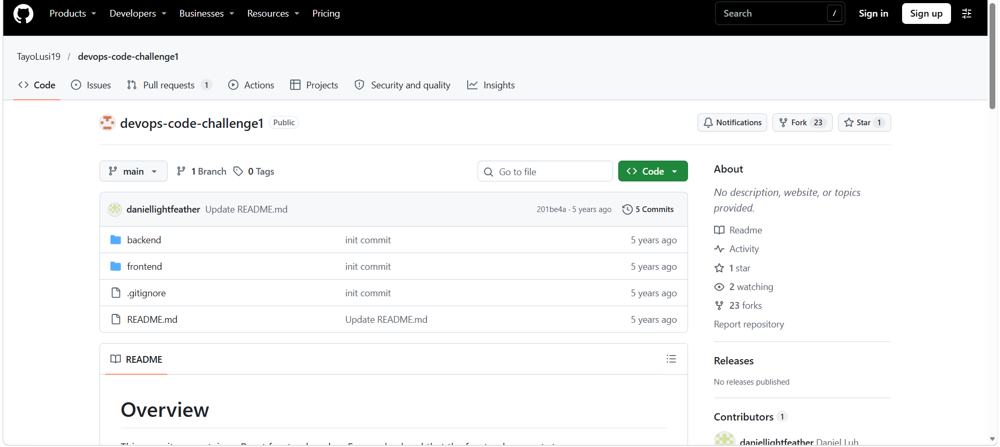
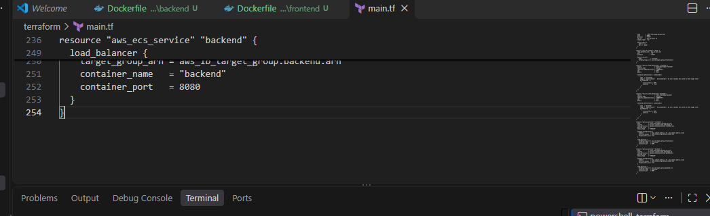
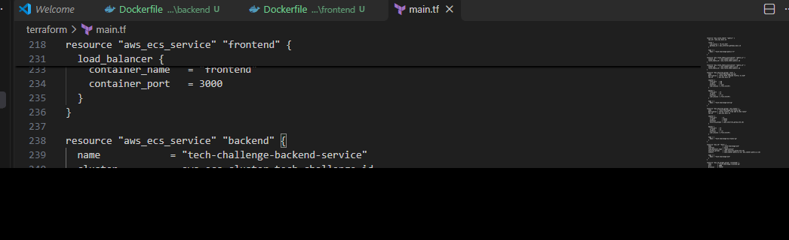
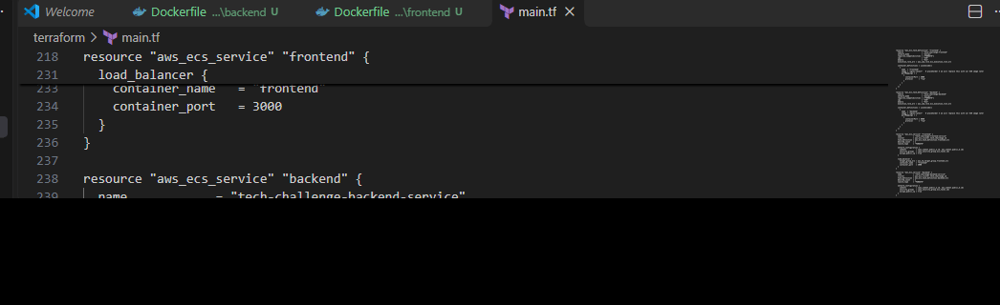

# ECS Fargate Deployment with Terraform

A production-style deployment of a containerized frontend and backend application on AWS using ECS Fargate and Infrastructure as Code. Terraform provisions the ECS cluster, Application Load Balancer, ECR repositories, IAM roles, and networking. Docker images are built and pushed to ECR, with the load balancer routing `/api` traffic to the backend and all other traffic to the frontend.

This project demonstrates practical skills in infrastructure as code, container packaging, serverless compute, load balancing, and incremental troubleshooting of common ECS and ALB issues.

## Technologies

- **Terraform** – Infrastructure as Code for all AWS resources
- **Docker** – Packaging frontend and backend applications
- **AWS ECS Fargate** – Serverless container orchestration
- **Application Load Balancer (ALB)** – Layer-7 routing (`/api` → backend, default → frontend)
- **Amazon ECR** – Private container registry
- **IAM** – Task execution role for ECR pulls and CloudWatch logging
- **Node.js** – Application runtime
- **Git** – Source control

## Tools Overview

### Terraform
**Layman’s:** A tool that lets you write down the AWS pieces you want (like a load balancer or a container service) in a text file. You then tell Terraform “make it so,” and it creates or changes those pieces for you. You never have to click around in the AWS console.

**Technical:** An open-source Infrastructure-as-Code tool that uses HashiCorp Configuration Language (HCL). It maintains a state file and calls AWS APIs to create, update, or destroy resources.

### Docker
**Layman’s:** A tool that packages an application and everything it needs to run into a single “box” called an image. That box can be started on any computer that has Docker, and it will behave the same way.

**Technical:** A containerization platform. Images are built from Dockerfiles and run as containers. Docker Desktop on Windows was used.

### AWS ECS Fargate
**Layman’s:** AWS’s way of running Docker containers without you having to manage any servers. You just say “run this container” and AWS handles the computers behind the scenes.

**Technical:** A serverless compute engine for Amazon ECS. Tasks run on AWS-managed infrastructure; there are no EC2 instances to patch or scale yourself.

### Application Load Balancer (ALB)
**Layman’s:** The single public web address that visitors use. It looks at each request and decides which container should handle it.

**Technical:** A Layer-7 load balancer that can route traffic based on path, host, or headers. In this project it routes `/api` to the backend and everything else to the frontend.

### Target Group
**Layman’s:** A list of the containers that are healthy and ready to receive traffic. The load balancer uses this list to know where to send requests.

**Technical:** An ALB construct that contains one or more registered targets (in this case, Fargate task IP addresses) and performs health checks against them.

### Listener
**Layman’s:** The part of the load balancer that actually listens for incoming web requests (usually on port 80). It has rules that say “if the request looks like this, send it to that target group.”

**Technical:** An ALB listener checks for connection requests on a protocol and port and forwards them to a target group according to rules.

### ECR (Elastic Container Registry)
**Layman’s:** AWS’s private storage place for Docker images. It is like a private Docker Hub that only your account can use.

**Technical:** A fully managed Docker container registry that integrates with IAM and ECS.

### IAM Execution Role
**Layman’s:** A set of permissions that the ECS service uses so it can pull images from ECR and send logs to CloudWatch.

**Technical:** An IAM role assumed by the ECS agent, typically attached to the `AmazonECSTaskExecutionRolePolicy`.

## Common Commands

```bash
terraform init / plan / apply / destroy
docker build / tag / push / images
aws ecr get-login-password | docker login
aws ecs update-service --force-new-deployment
aws elbv2 describe-target-health
curl http://...
git clone
```

## Implementation Steps

### Step 1: Create Isolated Workspace
**Working Location:** Desktop  
**Commands / Actions:** Create a new folder named `ecs-fargate-terraform` on the Desktop and open it in VS Code.

**Layman’s Explanation:** Think of this like starting a brand-new binder for a new class. If you put all of your notes for this project into an old binder that already has other work in it, you might accidentally throw away or mix up the wrong papers. By creating a completely empty new folder, everything stays inside that one binder and cannot touch any other projects or repositories.

**Technical Explanation:** An isolated working directory keeps Terraform state files, Docker build context, and any temporary files completely separate from other repositories.

**Why it matters before the next step:** Every command later runs inside this folder. Starting clean removes the risk of accidentally changing files that belong to a different project.

**Verification:** The new folder is visible on the Desktop and is the root of the VS Code window.

### Step 2: Confirm Terraform, Docker, and Node.js
**Working Location:** Terminal inside the project folder  
**Commands / Actions:** `terraform --version`; `docker --version`; `node --version`

**Layman’s Explanation:** Before building anything, confirm that the three tools needed are installed and working.

**Technical Explanation:** Terraform creates the AWS infrastructure, Docker builds the container images, and Node.js runs the application code.

**Why it matters before the next step:** If any tool is missing it would be discovered later and force a stop. Checking first means the foundation is solid.

**Verification:** All three commands return version numbers.

**Common errors and fixes:** npm fails → `Set-ExecutionPolicy -ExecutionPolicy RemoteSigned -Scope CurrentUser`

### Step 3: Clone the Application Repository
**Working Location:** Project folder  
**Commands / Actions:** `git clone https://github.com/TayoLusi19/devops-code-challenge1.git`

**Layman’s Explanation:** Download the starter code so it can be reviewed, modified, and packaged into Docker images.

**Technical Explanation:** Creates a local copy of the public repository inside the isolated folder.

**Why it matters before the next step:** Source code is required on disk before building images or understanding how the frontend talks to the backend.

**Verification:** `devops-code-challenge1` folder appears with frontend and backend subdirectories.



### Steps 4–8: Incremental Terraform Configuration
**Working Location:** `terraform/main.tf`  
**Commands / Actions:** Add resources one block at a time and run `terraform plan` after each addition.

**Layman’s Explanation:** Add one small piece, check that Terraform understands it, then add the next piece. This makes mistakes much easier to find.

**Technical Explanation:** Each plan shows exactly which new resources will be created. The resource count increases predictably.

**Why it matters before the next step:** Checking after each addition confirms the infrastructure is still valid before moving on.

**Verification:** `terraform plan` succeeds and the count matches the resources just added.

**Common errors and fixes:** Plan count does not increase → Ctrl+S before re-running plan.




### Step 9: Remove Invalid Backend load_balancer Block
**Working Location:** `terraform/main.tf`  
**Commands / Actions:** Delete the entire `load_balancer` block from the `aws_ecs_service "backend"` resource.

**Layman’s Explanation:** A target group is simply a list of healthy containers that are ready to receive traffic. A listener is the part of the load balancer that actually watches for incoming web requests and uses rules to decide which target group should handle each request. AWS has a rule that says a service is not allowed to register itself with a target group unless that target group is already attached to at least one listener. In this step the backend target group existed, but no listener rule was pointing at it yet, so AWS rejected the registration. It is like trying to put mail into a mailbox that has not been given a street address yet.

**Technical Explanation:** An ECS service can only register with a target group that is associated with a load balancer listener. At that moment only the frontend target group was attached. The backend target group had no listener association, so the CreateService API call failed.

**Why it matters before the next step:** Removing the block lets the apply succeed. The correct listener rule is added later once the backend is ready to receive traffic.

**Verification:** `terraform apply` completes with no errors.

**Common errors and fixes:** Error: “The target group does not have an associated load balancer”. Fix: remove the `load_balancer` block until a listener rule exists for the backend target group.



### Step 10: Build, Tag, and Push Images to ECR
**Working Location:** frontend and backend folders  
**Commands / Actions:** `docker build`, `docker tag`, `docker push`

**Layman’s Explanation:** Package the application into Docker images and upload them to AWS’s private registry so ECS can download them later.

**Technical Explanation:** `docker tag` adds the full ECR repository URI as an additional name. `docker push` uploads the layers.

**Why it matters before the next step:** ECS Fargate can only pull images that exist in a registry it can reach. The images must be in ECR before the task definitions can use them.

**Verification:** `docker push` finishes and shows the image digest.

**Common errors and fixes:** Docker login 400 → use `cmd /c` wrapper.



### Step 11: Update Task Definitions with ECR Image URIs
**Working Location:** `terraform/main.tf`  
**Commands / Actions:** Replace `nginx:latest` with the full ECR URI in both task definitions.

**Layman’s Explanation:** Change the task definitions from pointing at a placeholder web server to pointing at the real application images that were just uploaded.

**Technical Explanation:** The `container_definitions` JSON now references the ECR images.

**Why it matters before the next step:** The next apply will start containers that actually run the frontend and backend.

**Verification:** `terraform apply` succeeds.


### Step 12: Fix Hardcoded localhost URL in Frontend
**Working Location:** `frontend/src/config.js`  
**Commands / Actions:** Change `API_URL` from `http://localhost:8080/` to the ALB DNS + `/api`

**Layman’s Explanation:** The frontend was trying to call a backend on the visitor’s own computer. When the page is loaded from the public ALB, that address does not exist.

**Technical Explanation:** `API_URL` is read at build time and baked into the JavaScript bundle.

**Why it matters before the next step:** Without this change the browser will always fail to reach the backend.

**Verification:** New image built, pushed, and force-new-deployment issued.

**Common errors and fixes:** “Failed to fetch”.


### Step 13: Fix ALB Listener Rule Path Pattern
**Working Location:** `terraform/main.tf`  
**Commands / Actions:** Change path pattern from `["/api/*"]` to `["/api", "/api/*"]`

**Layman’s Explanation:** The rule only matched paths that had something after `/api/`. A request to exactly `/api` did not match, so it went to the frontend, which returned HTML. The browser expected JSON and failed.

**Technical Explanation:** ALB path patterns are not recursive. `/api/*` requires additional characters after the slash.

**Why it matters before the next step:** Requests to `/api` now reach the backend and return proper JSON.

**Verification:** Browser displays a UUID.

**Common errors and fixes:** `curl` to `/api` returned HTML. The error “Unexpected token '<' is not valid JSON” means the JavaScript parser saw the “<” from HTML when it expected JSON.


### Final Verification
**Working Location:** Browser  
**Commands / Actions:** Refresh the ALB URL

**Layman’s Explanation:** The page shows a UUID (Universally Unique Identifier) – a unique ID generated by the backend. Seeing it means the frontend successfully called the backend through the load balancer.

**Technical Explanation:** End-to-end path is working.

**Why it matters:** The deployment is complete and functional.

**Verification:** UUID is displayed.


## Key Takeaways

- Incremental Terraform changes with frequent `plan` cycles isolate errors early.
- ECS services can only register with target groups that are attached to a listener.
- ALB path patterns are not recursive — both `/api` and `/api/*` are often required.
- Frontend API URLs must be build-time configurable when moving from localhost to a public load balancer.
- Fargate + ALB + ECR provides a clean serverless container deployment pattern without managing EC2 instances.

## Project Structure

```
ecs-fargate-terraform/
├── devops-code-challenge1/
│   ├── frontend/
│   └── backend/
├── terraform/
│   └── main.tf
├── screenshots/
└── README.md
```

This project demonstrates end-to-end infrastructure provisioning, container packaging, service orchestration, and common production troubleshooting patterns used in modern cloud environments.
