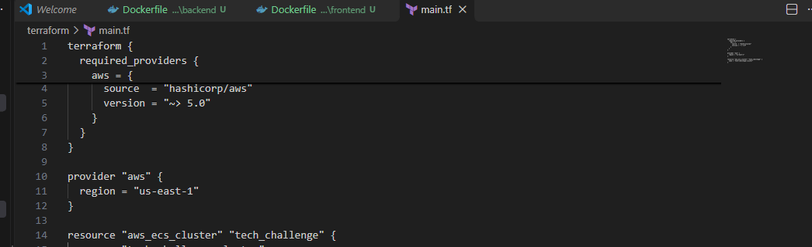
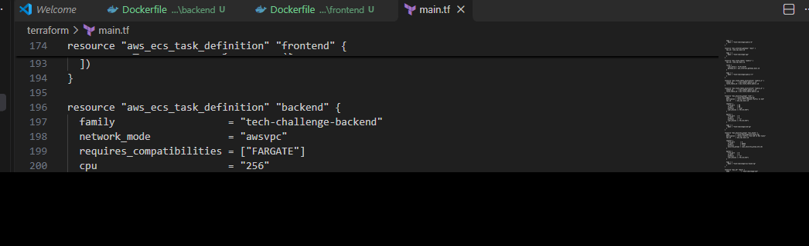
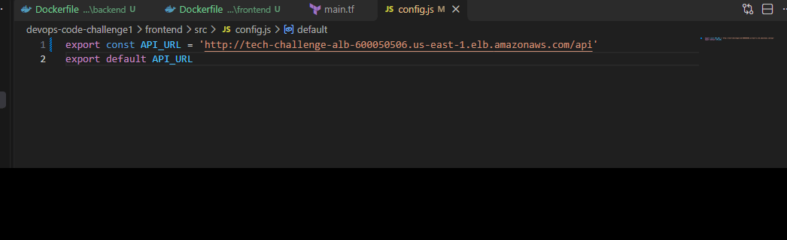
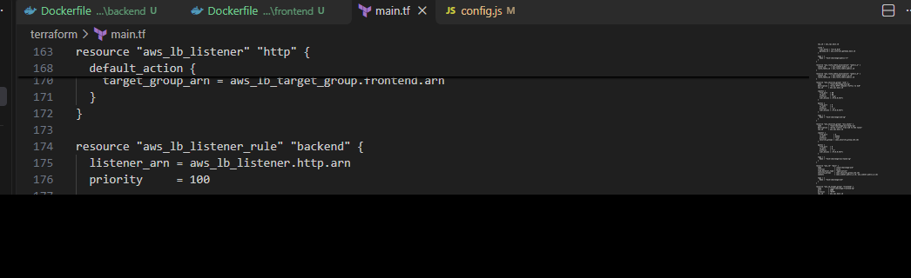
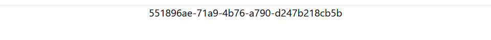

# ECS Fargate Deployment with Terraform

A containerized frontend and backend application deployed to AWS ECS Fargate using Terraform. The infrastructure includes an Application Load Balancer for path-based routing, Amazon ECR for image storage, and IAM roles for task execution. Docker images are built and pushed to ECR, with the ALB directing `/api` traffic to the backend and all other traffic to the frontend.

## Technologies

- Terraform
- Docker
- AWS ECS Fargate
- Application Load Balancer (ALB)
- Amazon ECR
- IAM
- Node.js

## What I Did

- Provisioned an ECS Fargate cluster, services, task definitions, and networking with Terraform
- Configured an Application Load Balancer with target groups and listener rules for path-based routing
- Built and pushed Docker images for the frontend and backend to Amazon ECR
- Created an IAM execution role for ECR image pulls and CloudWatch logging
- Updated task definitions to use the ECR image URIs
- Configured the frontend to call the backend through the ALB instead of localhost
- Adjusted ALB listener rules so both `/api` and `/api/*` routes reach the backend
- Verified end-to-end functionality with the backend returning a UUID through the load balancer

## Project Structure

```
ecs-fargate-terraform/
├── devops-code-challenge1/
│   ├── frontend/
│   └── backend/
├── terraform/
│   └── main.tf
├── screenshots/
└── README.md
```

## Key Files

- **terraform/main.tf** — ECS cluster, services, task definitions, ALB, target groups, listener rules, and IAM role
- **frontend/src/config.js** — API endpoint configured to the ALB
- **Dockerfiles** — Container build instructions for frontend and backend












